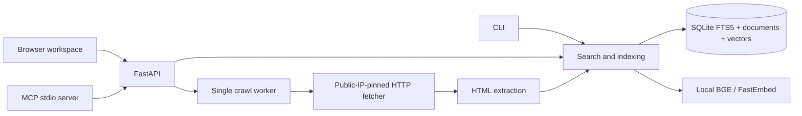

# Architecture

Open Scout is an independent implementation. REA was an investigation tool, not a
search backend or dependency in the application.

## Retrieval

Each normalized URL has a stable SHA-256-derived ID. Re-indexing replaces its text,
FTS entry, and chunk vectors in one SQLite transaction. WAL and per-operation
connections allow API reads while the crawl worker writes. Foreign keys remove
vectors when a document is deleted.

Keyword retrieval quotes up to 64 query tokens into an OR query and uses FTS5's
BM25 order with title boosting. Domain filters use exact hostname or subdomain
boundaries and apply before the result limit. In neural mode pages split into
overlapping 1,200-character passages; the title is prepended for embedding. The
local model uses separate query and passage embedding entry points. Cosine
similarity scores each chunk; the maximum chunk score represents a document.

Hybrid retrieval uses reciprocal rank fusion (k=60). Returned scores are ranking
weights, not confidence. Highlights are extractive sentence selections. The API
never generates unsourced answers. Similar-page search uses the source title and
opening text as a query and excludes its normalized URL.

## Crawling and jobs

A single background worker accepts one bounded BFS crawl at a time. The crawler
checks robots rules before every page/redirect hop, stays on explicitly seeded
hostnames, and records errors per attempted page. The page limit counts failed
attempts too. The queue, link depth, body size, extracted length, and loop duration
are capped. A completed crawl can contain failed/skipped pages; inspect `errors`
and `indexed`, not just the job status.

Every HTTP hop resolves DNS, rejects any non-public answer, then connects to a
chosen validated IP. HTTPS preserves the original SNI and certificate hostname.
Environment proxies are not used. Redirects repeat these checks; redirects to new
seed hosts also check those hosts' robots files. Gzip/deflate expansion is bounded.
Page noindex directives prevent storage and remove a previous copy on recrawl.

Jobs are stored as JSON in SQLite. On startup queued/running jobs become
`interrupted`; there is no automatic resume. There is no scheduler or distributed
queue. Use one API process and stop it before CLI crawling/reindexing.

## API and browser

FastAPI validates all payloads and rejects unknown fields. Requests are bounded
to 64 KiB. All data endpoints check `x-api-key` when configured; health and static
assets remain public. Without a key, trusted Host headers restrict DNS rebinding.
The CLI refuses non-loopback binds without a 24-character key. CORS is not enabled.
POST requires JSON, so cross-origin HTML forms cannot start crawls.

The browser is dependency-free HTML/CSS/JavaScript. Source content is inserted via
`textContent`, never interpreted as HTML. A restrictive CSP disallows inline script
and framing. API keys live only in tab memory. MCP exposes read/search tools over
stdio and forwards them to the same HTTP API with configured credentials.

## Scaling boundary

This release favors a reproducible laptop installation over global infrastructure.
Search reads stored documents and scans vectors in memory, so it is intended for
thousands of pages. Large indexes need a vector service/ANN index, pagination and
candidate retrieval improvements, a distributed crawler, recrawl scheduling,
quality evaluation, and resource quotas. Those are future work, not hidden services.
